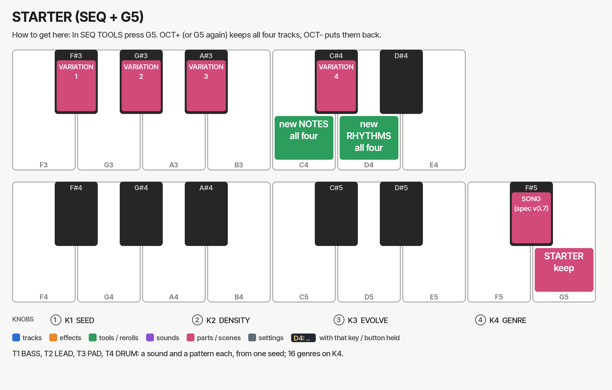
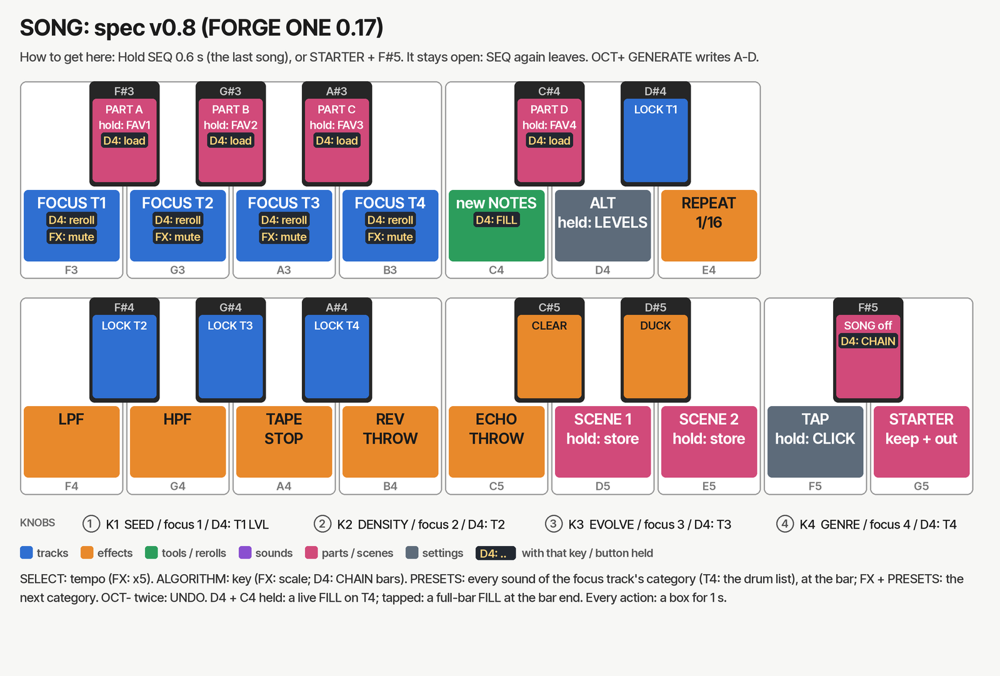

# FORGE User Guide

FORGE 0.13 in FORGE ONE (Felucca 1.6.1) · M-VAVE FM-1

FORGE writes a musical idea onto a track in one key press, then lets that idea evolve: a melody on a synth track,
a beat on a DRUM track (section 6). From 0.6, **STARTER** on the G5 key writes all four tracks at once, sounds
included (section 7). FORGE lives in
Felucca's SEQ TOOLS layer on the **F5** key. Every pattern comes from a **seed**: the same seed and settings
always give the same steps, so you can note a seed you like and get the pattern back later.

All values in this guide are starting points. Judge the result by ear and turn the knobs until it sits right.

## 1. Quick start

1. Choose a track with **ALGORITHM**. This quick start is for a synth track; a DRUM track makes a beat instead (section 6).
2. Set the track's **ROOT** and **SCALE** on the SCL page, and its length with SEQ TOOLS' **K1 LEN**.
   FORGE reads all three, so set them first.
3. Press **PLAY** if you want to hear the result as you work.
4. Hold **SEQ** and tap **F5**. A pattern is written at once, and the screen shows it as a grid of steps.
5. Turn **K1 SEED** until you hear an idea you like. Then shape it with **K2 DENSITY**, **K3 EVOLVE** and **K4 STYLE**.
   Like the rhythm but not the notes? Press **C4** for new notes. Like the notes but not the rhythm? Press **D4**.
6. Press **OCT+** to keep it, or **OCT−** to put the old steps back.

If you change your mind after keeping a pattern, hold **SAVE** to undo the whole FORGE in one step, as long as you
have not used another SEQ TOOLS key since.

## 2. Controls while FORGE is open

| Control | What it does | Range |
| --- | --- | --- |
| **K1 SEED** | Picks the pattern. Each seed is a different idea; turning past 99 wraps to 0 | 0–99 |
| **K2 DENSITY** | How many of the style's steps sound; above 75 % it also adds notes off the style's rhythm | 10–100 %, steps of 5 |
| **K3 EVOLVE** | How much the idea changes across the pattern and from loop to loop (section 4) | 0–4 |
| **K4 STYLE** | The rhythm and pitch profile (section 3). Choosing a style sets DENSITY to that style's default; turning past AMBIENT wraps to BERLIN | 8 styles |
| **C4** (RANDOM) | New notes on the same rhythm. Each press is the next variation | NOTES 0–99 |
| **D4** (COOK) | A new rhythm; each step that still sounds keeps its pitch (with EVOLVE, later copies may drift differently) | RHYTHM 0–99 |
| **OCT+** | Keep the pattern and close FORGE | |
| **OCT−** | Cancel: the track's steps go back to how they were before FORGE opened | |
| **F5** again | Keep the pattern (same as OCT+) | |
| Another SEQ TOOLS key (not C4 or D4) | Keeps the FORGE pattern, then runs that tool | |
| Letting go of **SEQ** | Keeps the pattern | |
| **SAVE** held (afterwards) | Undo the whole FORGE: the steps and their locks come back (if no other tool ran since) | |

Turning the knobs while the sequencer plays is safe: each step is replaced whole, so you never hear half-written
steps. Each knob turn rewrites the pattern from the steps as they were before FORGE opened, so turning a knob back
returns the earlier pattern exactly. The exception is STYLE: any turn of K4 sets DENSITY to the style's default,
so set DENSITY after choosing the style.

**What the screen shows.** Each time FORGE opens or a knob turns, the header briefly shows `FORGE <seed> <style>`,
for example `FORGE 42 BERLIN`. The four knob
cards show SEED, DENSITY, EVOLVE and STYLE. Below them, every step of the pattern is a cell, 16 to a row:

- a **bright cell** is a note, with a small mark at its pitch (higher mark, higher note)
- a **half-bright cell** is a tie, holding the note before it
- a **dark cell** is a rest

Under the cells, **C4 NOTES** and **D4 RHYTHM** show how many times you have rerolled each (lit once above 0).
Turning K1 SEED or K4 STYLE sets both back to 0.

The footer shows **OCT+ APPLY** and **OCT− CANCEL**. With MENU > SYSTEM > HELP on, a second row shows
K1 SEED, K3 EVOLVE and K4 STYLE.

**F5 lights up** while FORGE is open.

## 3. The eight styles

| Style | Knob card | Motif | Rhythm | Pitch | Octave | Default DENSITY |
| --- | --- | --- | --- | --- | --- | --- |
| BERLIN | BERLIN | 8 steps | 16th ostinato, accents on 1 and 9 | Small steps around the root | C3 | 85 % |
| DETROIT | DETROIT | 16 | Syncopated stabs | 4-note scale chords | C4 | 70 % |
| DUB | DUB | 16 | Off-beats, long ties | 3-note scale chords, narrow range | C3 | 55 % |
| MELODIC | MELO | 16 | 8ths | Rises then falls in an arc | C4 | 75 % |
| ACID | ACID | 16 | 16ths with accents and slides | Root pedal, other notes nearby, octave jumps | C2 | 75 % |
| TRANCE | TRANCE | 8 | Rolling 16ths | Arpeggios of the scale's triad and octave | C4 | 90 % |
| SYNTH | SYNTH | 8 | 8ths | Root, fifth and octave, a third now and then | C3 | 90 % |
| AMBIENT | AMBI | 16 | Very sparse, long ties | Wide intervals, some 3-note chords | C4 | 50 % |

- **Motif** is the length of the idea before it repeats. If LEN is shorter than the motif, the motif is LEN steps long.
- **Octave** is where the root sits: the root note is the track's ROOT in that octave (A minor on ACID starts on A2).
  Melodies move a few scale steps above and below the root (AMBIENT more than an octave). Octave jumps only go up.
- **Step 1 is always the root**, so every pattern starts at home.
- **The scale decides the notes.** Every note is in the track's ROOT and SCALE. Chords, and the TRANCE and SYNTH
  arpeggios, are built from real intervals (a third, fifth and seventh above the note) kept inside the scale, so
  they work in every scale. In CHR the chords are minor (root, minor third, fifth, minor seventh); in the
  pentatonic scales the "seventh" is the scale's sixth; in WHOLE the chords are augmented.
- **The knob card** shortens MELODIC and AMBIENT so they fit. The header shows the full names.

**Picking a sound for each style.** These are starting points:

| Style | Try it on |
| --- | --- |
| BERLIN | ANALOG or PHASE with a short decay; a slow LFO on the filter |
| DETROIT | WHEEL, FM6 or ANALOG pads with a short envelope; a 1/8D delay |
| DUB | ANALOG or FM6 chords with HALL reverb and a dotted delay; ECHO THROW in the FX layer |
| MELODIC | FM6, PHASE or TRIO leads |
| ACID | ANALOG with resonance up, MONO or LEGATO voice mode so the slides glide |
| TRANCE | ANALOG or TRIO with the gate short; the SLICER for movement |
| SYNTH | ANALOG or LOFI bass |
| AMBIENT | GRAIN, PHYS or FM6 pads with long release and HALL reverb |

Chords need a polyphonic track: set the voice mode to **POLY** on EDIT > VOICE (K1). On MONO, LEG or UNI only one
note of each chord sounds.

**The track's sound sets the role (0.12).** FORGE reads the category of the selected track's sound (the one the
PRESETS list filters by: BASS, LEAD, PAD, PLUCK, KEYS, ...; a FORGE PACK sound has its base preset's) and fits the
style to it. The STYLE still sets the genre; the role sets the register and the shape:

| Sound | What FORGE writes | The header says |
| --- | --- | --- |
| **BASS** (e.g. ANALOG SQR BASS, SUB BASS, ACID; T1's default) | Single notes, no chords, in the octave of C2, close to the root (MELODIC, TRANCE and AMBIENT walk the root, fifth and octave instead of arcs, arpeggios and wide leaps) | `BASS 42 BERLIN` |
| **PAD** (e.g. ANALOG SOFT PAD, STRINGS, VOICE CHOIR AAH, GRAIN CLOUD PAD) | A chord on the bar's 1 and 9 only, held with ties, moving by a scale step at a time, voiced between F#3 and F4 at the root; no slides, ratchets or octave jumps; EVOLVE only drops chords, never adds them | `PAD 42 BERLIN` |
| **LEAD, PLUCK, KEYS, FX, OTHER** | The style as it is (the table above) | `FORGE 42 BERLIN` |

To get a style exactly as written on a bass or pad sound, load a LEAD sound, open FORGE, apply, then change the
sound: the steps stay. STARTER is not affected: its parts are BASS, LEAD, PAD and DRUM by design.

## 4. EVOLVE: how the idea changes

FORGE writes the motif once, then copies it through the track's LEN. EVOLVE decides how much the copies differ
and how much each loop differs from the last.

| EVOLVE | What happens |
| --- | --- |
| **0** | A pure loop. Every copy is the motif, with no chance, conditions or ratchets |
| **1** | Later copies sometimes sit a scale step higher or lower, and a few notes move a step. A few ornament notes get a 75 % or 50 % chance. ACID and TRANCE ratchet a few notes |
| **2** | More drift. Some ornament notes get a **condition** instead of a chance: 2:2, 3:4, 2:4 or 4:4 |
| **3** | As 2, and later copies also drop a note or add one in a rest |
| **4** | The most change: drift, rhythm changes and ornaments on more notes |

- **The first copy keeps the motif's notes and rhythm.** Drift and note changes only happen in later copies, and
  build up the further along they are. The first copy can still get chances, conditions and (ACID, TRANCE) ratchets.
- **If LEN equals the motif length** (a 16-step style on LEN 16), there is only one copy, so EVOLVE only adds
  chances, conditions and ratchets. Use a longer LEN, or an 8-step style, to hear the copies drift.
- **Conditions** make one pattern change over several loops: a 4:4 note plays only on every fourth loop, and 2:2 only
  on every second. Each track counts its own loops from PLAY and from the start of each SONG section.
- **Chance** notes play on some loops and not others, so the line breathes.
- You can see and edit the chances and conditions FORGE wrote on **SEQ > DETAIL** (K1).

**For long-form playing**, try a short motif on a long LEN: for example BERLIN (8 steps) on LEN 64 at EVOLVE 2.
The ostinato stays recognisable while the copies and conditions keep it moving.

## 5. Recipes

These are starting points. Each one lists the track settings to make first, then the FORGE settings.

| Idea | Track settings | FORGE settings |
| --- | --- | --- |
| Berlin School sequencer | ANALOG, LEN 32, DIV 1/16, A MIN | BERLIN, DENSITY 85, EVOLVE 2 |
| Dub techno chord stab | FM6 or ANALOG, POLY, LEN 16, D MIN, HALL reverb | DUB, DENSITY 55, EVOLVE 1 |
| Rolling acid line | ANALOG, MONO, LEN 16, resonance up, E MIN | ACID, DENSITY 75, EVOLVE 1, then turn SEED |
| Melodic techno lead | FM6 or PHASE, LEN 32, F# MIN | MELODIC, DENSITY 70, EVOLVE 2 |
| Trance arpeggio | ANALOG or TRIO, LEN 16, gate short | TRANCE, DENSITY 90, EVOLVE 0 |
| Ambient drift | GRAIN or PHYS, POLY, LEN 64, DIV 1/8, C MAJ | AMBIENT, DENSITY 50, EVOLVE 3 |

**Working with a pattern you like.** Note its seed, style and the C4 / D4 numbers. After you apply it, the steps are ordinary Felucca steps:
edit single notes on SEQ > STEP, add parameter locks, or use the other SEQ TOOLS (REVERSE, SHIFT, COOK) on top.

## 6. FORGE on a drum track

From 0.5, F5 works on a DRUM track too. The same four knobs and the same eight style names make a **beat** instead
of a melody. The map shows FORGE as a small **F** cell at the right end of the lanes row.

| Control | On a DRUM track |
| --- | --- |
| **K1 SEED** | Picks the beat |
| **K2 DENSITY** | How many hits. Each style's main hits stay from 50 % up; above 75 % extra 16th hats and rim ghosts come in |
| **K3 EVOLVE** | 0 is a pure loop. From 1, later bars move a hat or two and add ghost snares and rims with a chance; from 2 the last bar ends in a **snare roll fill on a 4:4 condition** (every 4th loop); from 3 kicks off the beat come and go |
| **K4 STYLE** | The beat (table below). Sets DENSITY to the beat's default |
| **C4** (LOW) | New kick, snare, clap and tom; the hats stay |
| **D4** (HATS) | New hats, rim and bell; the low lanes stay |

The screen shows every step as a column of eight strips, KICK at the bottom and BELL at the top; a brighter strip is an
accent. At LEN 33 to 64 the strips would be too thin, so each step shows two columns of marks instead: kick, snare,
clap and tom on the left, hats, rim and bell on the right. The kick on step 1 is always there, and kicks on 1 and 9 are accented; snares and claps on 2 and 4 are
accented half the time. Velocity follows the beat as on melodic tracks. Lane mutes (EDIT layer) and lane levels
are not touched.

| Style | Kick | Snare / clap | Hats | Extras | Default DENSITY |
| --- | --- | --- | --- | --- | --- |
| BERLIN | Four on the floor | None | Straight 8ths, 16ths at high density | Rim ticks, an open hat | 70 % |
| DETROIT | Four on the floor, a push on 11 | Clap on 2 and 4 | 8ths, open hat off the beat | Tom, rim | 70 % |
| DUB | 1 and 9, a push on 11 | Rim on 2 and 4 | 8ths | Open hat | 55 % |
| MELODIC | Four on the floor | Clap on 2 and 4 | Off-beat 8ths, more at high density | Open hat, a tom on 16 | 70 % |
| ACID | Four on the floor, a push on 12 | Snare on 2 and 4, clap | Off-beat 16ths | Open hat, rim; the most ratchets | 75 % |
| TRANCE | Four on the floor | Clap on 2 and 4 | 8ths with open hats off the beat | Rim | 85 % |
| SYNTH | 1 and 7, a push on 12 | Snare on 2 and 4 | 8ths | Open hat, tom | 70 % |
| AMBIENT | 1 only | None | Sparse | Open hat, tom, rim, a bell | 45 % |

Pick the kit first (PRESETS, or tap **EDIT** on the DRUM track for EDIT 1, then K1 KIT: STD 80 10 66 55 77 DEEP TIGHT PERC 90 MP SD, the 0.14 kits 90 MP SD at the end; PRESETS has no new presets for them): the same beat sounds very different on 80, DEEP or PERC. The beat is
ordinary drum-grid steps once applied, so edit it on the grid, mute lanes in the EDIT layer, or run the lane tools over it.

## 7. STARTER: a song start on all four tracks

**STARTER** (SEQ TOOLS **G5**, from 0.6) is FORGE for the whole song. One press loads a sound on each of the four
tracks and writes a pattern for each, all from one seed:

| Track | Part |
| --- | --- |
| T1 | BASS |
| T2 | LEAD |
| T3 | PAD (chords) |
| T4 | DRUM (T4 becomes a DRUM track) |

1. Select a track and set its **ROOT** on the SCL page. All four tracks take that ROOT. Leave SCALE on CHR to use the
   starter's own scale, or set one to use yours.
2. Hold **SEQ** and tap **G5** (on any track). Four sounds load and four patterns are written at once; the tempo goes
   to the starter's BPM (not when the FM-1 follows an external MIDI clock).
3. Turn **K4 GENRE** to choose one of 13 genres, and press **black keys 1–4** (F#3 G#3 A#3 C#4) to choose the
   genre's variation (3 or 4 each, 45 in all; the screen shows them as a row of cells, the keys light up). Each loads
   its own four sounds, tempo, scale and swing. Turn **K1 SEED** for another song idea in the same starter. **K2 DENSITY** makes all four busier or sparser (50–150 % of each part's own), and **K3 EVOLVE**
   works as in FORGE. **C4** gives all four new notes, **D4** new rhythms.
4. Press **OCT+** (or G5 again) to keep it, or **OCT−** to put all four tracks back exactly as they were: sounds,
   settings, steps, automation and tempo.

The screen shows a row a track: its preset and its first 16 steps. Under them, the C4 and D4 counts.

| Genre (K4) | Black key, variation | T1 bass | T2 lead | T3 pad | T4 kit · beat | BPM | Scale* | Swing |
| --- | --- | --- | --- | --- | --- | --- | --- | --- |
| Berlin | 1 **SEQ** | *BERLIN SEQ* | TRIO ARP LEAD | *BERLIN PAD* | DRUM DEEP KIT · Berlin | 120 | MIN | – |
|  | 2 **DRIFT** | LOFI WAVE BASS | *BERLIN RESO* | *STRING MACH* | DRUM PERC KIT · Ambient | 108 | MIN | – |
|  | 3 **CHOIR** | FM6 FM BASS | TRIO SYNC LEAD | *CHOIR PAD* | DRUM DEEP KIT · Berlin | 116 | HARM | – |
|  | 4 **ARP** | *DEEP BASS* | LOFI STEP LEAD | *BERLIN PAD* | *RHYTHM BOX* · Berlin | 124 | DOR | – |
| Detroit | 1 **STABS** | FM6 FM BASS | *WARM STAB* | FM6 TINE EP | *HOUSE KIT* · Detroit | 126 | DOR | – |
|  | 2 **STRNG** | *DEEP BASS* | ANALOG STRINGS | *HOUSE PIANO* | *HOUSE KIT* · Detroit | 128 | MIN | – |
|  | 3 **ELECT** | *ELECTRO BASS* | LOFI PULSE LD | PHASE STRING | *808 KIT* · Electro | 125 | PHRY | – |
|  | 4 **DEEP** | FM6 FM BASS | *GLASS ARP* | ANALOG SOFT PAD | DRUM DEEP KIT · Melodic | 124 | MIN | – |
| Dub Techno | 1 **CHORD** | *DUB SUB* | *DUB CHORD* | GRAIN SHIMMER | *DUB KIT* · Dub | 118 | DOR | – |
|  | 2 **DEEP** | VOICE WOW BASS | FM6 PAD | GRAIN CLOUD PAD | *DUB KIT* · Dub | 120 | MIN | – |
|  | 3 **MINI** | *DUB SUB* | PHASE RESO | *DUB PAD* | *909 KIT* · Dub | 124 | DOR | – |
|  | 4 **ECHO** | ANALOG SUB BASS | FM6 TINE EP | GRAIN FROZEN | *DUB KIT* · Dub | 116 | MIN | – |
| Melodic | 1 **ARC** | TRIO FAT BASS | ANALOG SAW LEAD | FM6 PAD | DRUM DRUM KIT · Melodic | 122 | MIN | – |
|  | 2 **ARP** | *DEEP BASS* | TRIO SYNC LEAD | *TRANCE PAD* | DRUM TIGHT KIT · Melodic | 124 | MIN | – |
|  | 3 **PIANO** | FM6 FM BASS | SAMPLE PIANO | GRAIN CLOUD PAD | DRUM DEEP KIT · Melodic | 122 | DOR | – |
|  | 4 **PLUCK** | TRIO FAT BASS | *TRANCE PLUCK* | *CHOIR PAD* | DRUM DRUM KIT · Melodic | 123 | MIN | – |
| Acid House | 1 **CLASS** | *ACID 303* | *HOUSE PIANO* | ANALOG SOFT PAD | *HOUSE KIT* · Deep house | 124 | MIN | 10% |
|  | 2 **JACK** | *ACID SQUARE* | ANALOG RAVE | *CHOIR AAH* | *HOUSE KIT* · Deep house | 122 | DOR | 15% |
|  | 3 **FLOOR** | *ACID 303* | LOFI ARP 8BIT | PHASE ORGAN | DRUM DRUM KIT · Acid | 128 | MIN | – |
| Acid Techno | 1 **ROLL** | ANALOG ACID | *CHIP ARP* | ANALOG SOFT PAD | *909 KIT* · Acid | 128 | MIN | – |
|  | 2 **WARE** | *ACID SQUARE* | LOFI STEP LEAD | ANALOG PWM STR | *909 KIT* · Acid | 135 | MIN | – |
|  | 3 **HARD** | *ACID 303* | FM6 BRASS | PHASE WIRE | *909 KIT* · Acid | 140 | PHRY | – |
| Trance | 1 **GATE** | ANALOG SUB BASS | TRIO ARP LEAD | *TRANCE PAD* | *HOUSE KIT* · Trance | 138 | MIN | – |
|  | 2 **LIFT** | ANALOG SUB BASS | *SUPERSAW* | *CHOIR PAD* | *HOUSE KIT* · Trance | 138 | MIN | – |
|  | 3 **PSY** | ANALOG SQR BASS | TRIO RING BELL | PHASE RESO | DRUM TIGHT KIT · Trance | 142 | PHRY | – |
| Deep House | 1 **KEYS** | *HOUSE BASS* | FM6 TINE EP | ANALOG SOFT PAD | DRUM DEEP KIT · Deep house | 122 | DOR | 15% |
|  | 2 **ORGAN** | VOICE WOW BASS | *HOUSE ORGAN* | ANALOG STRINGS | *HOUSE KIT* · Deep house | 120 | MIN | 20% |
|  | 3 **VOCAL** | ANALOG SUB BASS | *VOX CHANT* | FM6 PAD | DRUM DEEP KIT · Deep house | 121 | MIN | 10% |
| Synthwave | 1 **DRIVE** | *OCTAVE BASS* | ANALOG SAW LEAD | ANALOG PWM STR | *SIMMONS KIT* · Synthwave | 110 | MIN | – |
|  | 2 **NIGHT** | TRIO FAT BASS | *BRASS STAB* | FM6 PAD | *SIMMONS KIT* · Synthwave | 98 | MIN | – |
|  | 3 **8BIT** | LOFI WAVE BASS | *8BIT LEAD* | TRIO CHIP CHOIR | DRUM TIGHT KIT · Synthwave | 118 | MAJ | – |
| Breakbeat | 1 **AMEN** | *REESE* | FM6 BRASS | ANALOG STRINGS | *BREAK KIT* · Breakbeat | 134 | MIN | 10% |
|  | 2 **NUSK** | *ACID SQUARE* | LOFI STEP LEAD | PHASE STRING | *BREAK KIT* · Breakbeat | 135 | PHRY | 5% |
|  | 3 **ELECT** | *ELECTRO BASS* | *SCREAM* | FM6 PAD | *808 KIT* · Electro | 128 | MIN | 5% |
| Ambient | 1 **CLOUD** | *DRONE BASS* | FM6 BELL | GRAIN CLOUD PAD | DRUM PERC KIT · Ambient | 80 | LYD | – |
|  | 2 **DRONE** | PHYS DRONE STRING | SAMPLE FLUTE | *AIR PAD* | DRUM PERC KIT · Ambient | 72 | DOR | – |
|  | 3 **GLASS** | *DRONE BASS* | PHYS MARIMBA | *CHOIR PAD* | DRUM PERC KIT · Ambient | 84 | LYD | – |
|  | 4 **RAIN** | FM6 FM BASS | TRIO RING BELL | *GLASS PAD* | DRUM PERC KIT · Ambient | 76 | MIN | – |
| Lo-Fi | 1 **PIANO** | *LOFI BASS* | SAMPLE PIANO | *LOFI PAD* | *808 KIT* · Lo-fi | 84 | DOR | 25% |
|  | 2 **TAPE** | TRIO FAT BASS | *WARM KEYS* | WHEEL SOFT FLUTE | DRUM DRUM KIT · Lo-fi | 88 | MIN | 20% |
|  | 3 **SAX** | *LOFI BASS* | SAMPLE SAX | FM6 PAD | DRUM PERC KIT · Lo-fi | 80 | DOR | 22% |
| Jarre | 1 **OXY** | ANALOG SQR BASS | *OXY LEAD* | *STRING MACH* | *MINI KIT* · Rhythm box | 104 | MIN | – |
|  | 2 **EQUI** | LOFI WAVE BASS | TRIO ARP LEAD | *CHOIR AAH* | *MINI KIT* · Electro | 120 | MIN | – |
|  | 3 **FIELD** | FM6 FM BASS | *BRASS STAB* | ANALOG PWM STR | *MINI KIT* · Rhythm box | 112 | DOR | – |
|  | 4 **ZOO** | VOICE WOW BASS | *VOX CHANT* | GRAIN SHIMMER | DRUM TIGHT KIT · Electro | 118 | PHRY | – |

\* The starter's SCALE is used only when the selected track's SCALE is CHR (the default). Any other SCALE you set is kept.

**FORGE PACK (0.9).** Sounds in *italics* in the table are from the FORGE PACK: 43 sounds (0.14) made for the starters.
Each is a factory preset with its own settings on top (oscillator and filter, envelope, voice mode and glide, unison,
the effect sends, the LFO), exactly as if you had turned the knobs yourself. So PRESETS shows the factory preset's
name, a project saves them like any edited sound, and they open on stock Felucca and in the Felucca web editor. To
keep one for other songs, save it with **SAVE > USER** while the track has it.

| Sound | Built on | Character |
| --- | --- | --- |
| **BERLIN SEQ** | ANALOG SQR BASS | Resonant square sequence, short decay, a little delay |
| **DEEP BASS** | ANALOG SUB BASS | Two detuned saws, legato with a touch of glide |
| **DUB SUB** | ANALOG SUB BASS | Round sine sub with a little drive |
| **ACID 303** | ANALOG ACID | Saw, high resonance, strong filter envelope, slide, driven |
| **ACID SQUARE** | ANALOG ACID | The square-wave acid line |
| **HOUSE BASS** | TRIO FAT BASS | Short three-pulse bass |
| **OCTAVE BASS** | ANALOG SQR BASS | Bright saw for octave 16ths |
| **REESE** | TRIO FAT BASS | Detuned three-saw bass with a slow filter wobble |
| **DRONE BASS** | ANALOG SUB BASS | Slow-swelling triangle drone, reverb, slow filter drift |
| **LOFI BASS** | ANALOG SUB BASS | Warm, dull triangle bass |
| **ELECTRO BASS** | LOFI WAVE BASS | 8-bit pulse bass, tight |
| **SUPERSAW** | ANALOG SAW LEAD | Unison saws, wide spread, chorus, delay and reverb |
| **TRANCE PLUCK** | ANALOG PLUCK | Bright saw pluck with delay |
| **OXY LEAD** | ANALOG SAW LEAD | Slow PWM lead with glide and vibrato, long reverb |
| **SCREAM** | TRIO SYNC LEAD | Hard sync lead with drive |
| **BERLIN RESO** | PHASE RESO | Phase-distortion resonant blip with delay |
| **BRASS STAB** | ANALOG BRASS | Saw brass with a filter swell |
| **DUB CHORD** | ANALOG PLUCK | Short filtered chord for dub, heavy delay and reverb |
| **WARM STAB** | ANALOG PWM STR | PWM chord stab, chorus |
| **HOUSE PIANO** | SAMPLE PIANO | The piano sample, brighter, a little drive |
| **HOUSE ORGAN** | WHEEL JAZZ PERC | Percussive organ, fast rotor |
| **GLASS ARP** | FM6 BELL | FM bell with delay and reverb |
| **8BIT LEAD** | LOFI PULSE LD | 8-bit pulse lead with vibrato |
| **CHIP ARP** | LOFI ARP 8BIT | 8-bit minor arpeggio |
| **VOX CHANT** | VOICE VOX LEAD | Formant voice lead with glide |
| **WARM KEYS** | FM6 TINE EP | FM electric piano with chorus and tape wobble |
| **STRING MACH** | ANALOG STRINGS | Ensemble strings: detuned saws, heavy chorus · LEVEL −8 dB |
| **BERLIN PAD** | ANALOG SOFT PAD | Slow pad whose filter opens with the envelope · LEVEL −7 dB |
| **TRANCE PAD** | ANALOG PWM STR | Wide PWM pad · LEVEL −7 dB |
| **DUB PAD** | ANALOG SOFT PAD | Soft pad with delay · LEVEL −7 dB |
| **CHOIR PAD** | VOICE CHOIR AAH | Formant choir, slow · LEVEL −12 dB |
| **CHOIR AAH** | VOICE CHOIR AAH | The factory choir as it is, at LEVEL −12 dB (0.9.2) |
| **GLASS PAD** | GRAIN SHIMMER | Granular shimmer, long · LEVEL −7 dB |
| **AIR PAD** | NOISE WIND | Filtered noise, slowly drifting · LEVEL −7 dB |
| **LOFI PAD** | ANALOG SOFT PAD | Soft pad with hiss and tape wobble · LEVEL −7 dB |
| **808 KIT** | DRUM DEEP KIT | KIT 80: long, round kick; deep and boomy (0.14; was BOOM KIT) |
| **HOUSE KIT** | DRUM DRUM KIT | Punchy kit, snappy (0.14: on KIT 90) |
| **BREAK KIT** | DRUM TIGHT KIT | Bright, snappy, driven |
| **RHYTHM BOX** | DRUM PERC KIT | An early rhythm machine, soft |
| **909 KIT** | DRUM TIGHT KIT | KIT 90: the later analog drum machine, a click on the kick, bright hats (0.14; was TECHNO KIT) |
| **MINI KIT** | DRUM PERC KIT | KIT MP: the 70s organ-top rhythm box, soft: bongo, claves, maracas (0.14) |
| **SIMMONS KIT** | DRUM DEEP KIT | KIT SD: the 80s electronic kit, swept kick and big bent toms (0.14) |
| **DUB KIT** | DRUM DEEP KIT | Deep kit with delay and reverb on the drums |

These were designed without listening on the FM-1: every starter is checked to play all four tracks without silence or
clipping, but the balance between tracks (some leads are louder than their bass) is for your ears. Tell me which
sounds to change.

**What STARTER changes:** each track's sound (engine and factory preset, with its effect sends), its pattern, LEN,
DIV (1/16), ROOT and SCALE, and the tempo. Since 0.9.2 a pack pad also sets its track's LEVEL (the pads above; a
sustained chord peaks far above a bass line, and CHOIR AAH was too loud on the instrument). **It leaves alone:** PAN
and MUTE, LEVEL on every other sound, the master and the effects' own settings. Steps that held something before and are now empty lose their parameter locks when you
apply, as with FORGE; a sound load also drops automation of the old engine's own controls.

**Undo:** STARTER changes four tracks, and SAVE-held undo holds only one, so after STARTER it has nothing to undo.
**OCT−** while STARTER is open is the way back. Save your project first if it matters.

**Seeds:** the same SEED, C4 and D4 numbers, STARTER, DENSITY, EVOLVE and ROOT (and SCALE, if you set one) always
give the same four patterns. A set of starter seeds is pinned by a test, as FORGE's are.

**CPU:** each starter's four engines were chosen to play together, but FORGE ONE has not yet been tested on a real
FM-1. If you hear voices drop out, swap the pad for a lighter engine (ANALOG or FM6) on the EDIT layer.

**SONG (0.13): four parts and the arrangement from one seed.** With STARTER open, press **F#5** (the last black key).
SONG uses the starter's sounds, genre, SEED, DENSITY and EVOLVE (the knobs work as in STARTER) and makes four related
parts:

| Part (slot) | What it is |
| --- | --- |
| **A VERSE** | The starter as it is, a little sparser (DENSITY ×0.85, the lead ×0.7) |
| **B CHORUS** | Denser (×1.15), the lead an octave up and developed (EVOLVE +1), open hats on the off-beat 8ths, step 1 accented |
| **C BRIDGE** | A new motif, the bass and pad moved to the scale's 4th or 6th degree, a half-time beat (kick on 1, snare on 9) |
| **D LIFT** | (BERLIN, DEEP HOUSE, SYNTHWAVE, AMBIENT, JARRE) the last chorus bigger: lead and pad an octave up, DENSITY ×1.25, 8th hats, a fill on the last bar (AMBIENT: gentler, no hats or fill) |
| **D BREAK** | (the other 8 genres) the breakdown: no bass, no kick or snare, sparse hats, a snare roll building over the last bar, the pad's filter down and opening on the last bar |

- **Black keys 1–4** play part A–D (its steps go into the four tracks; the selected part is lit). **Black keys 5–8**
  lock T1–T4. **C4** rerolls the notes of the part shown and **F3–B3** one track, leaving locked tracks exactly as they
  are. **D4** is FOCUS (below).
- **OCT+ GENERATE** asks `OVERWRITE A-D?` and lists what is in the four project slots now (`--` for an empty one).
  **OCT+** writes the four parts to slots A–D, named `S42 VERSE`, `S42 CHORUS`, `S42 BRIDGE`, `S42 LIFT` or
  `S42 BREAK`, and writes the arrangement into GLO > SONG. **OCT−** cancels: no slot is touched and the four tracks
  go back to how they were before STARTER. The transport must be stopped to save (`STOP TO SAVE`).
- After writing, a reroll asks **`SAVE B?`** (for the part you rerolled): **OCT+** saves that slot only, **OCT−**
  keeps the change in the tracks without saving. OCT+ or OCT− otherwise closes SONG, leaving the part shown in the
  tracks. F#5 again goes back to plain STARTER.
- The arrangement (8 rows, edit it in GLO > SONG):

| Row | Section | T1 BASS | T2 LEAD | T3 PAD | T4 DRUM | Repeats (LIFT / BREAK genres) |
| --- | --- | --- | --- | --- | --- | --- |
| 1 | INTRO | - | - | A | A | 2 |
| 2 | VERSE | A | A | A | A | 4 |
| 3 | CHORUS | B | B | B | B | 4 |
| 4 | VERSE | A | A | A | A | 4 |
| 5 | BRIDGE | C | C | C | C | 2 |
| 6 | CHORUS / BREAK | B / D | B / D | B / D | B / D | 4 / 2 |
| 7 | LIFT / CHORUS | D / B | D / B | D / B | D / B | 4 |
| 8 | OUTRO | - | - | B | B | 2 |

The parts are ordinary projects and the arrangement an ordinary SONG chain, so stock Felucca 1.6.1 loads and plays
them too. Edit a part as usual: load its slot, change it, save it back to the same slot.

**Into SONG in one step (0.16, spec v0.7):** hold **SEQ for 0.6 s** (from anywhere, stopped or playing): SONG opens
straight away with the last song (its SEED, genre, key, scale, tempo, part, locks and rerolls; kept in the settings
when SONG is left or written), skipping the STARTER screen. A short SEQ tap is unchanged, and a key or knob touched
while SEQ is held cancels it. Entering SONG by any way locks the layer open, so SEQ need not be held: to leave, press
SEQ again (or HOME, or any page button). **MENU > SYSTEM > BOOT** `SONG` opens SONG with the last song at power-on,
stopped, on part A (`NORMAL`, the default, does not).

**SONG's keys** (spec v0.6, FORGE ONE 0.15; 0.16: spec v0.7). The columns: the key alone, with D4 held, with FX held.

| Key | Alone | D4 held | FX held |
| --- | --- | --- | --- |
| Black 1–4 (F#3 G#3 A#3 C#4) | Tap: part A–D (playing: at the next bar); **held 0.5 s: store FAV 1–4** (the part stays) | Load FAV 1–4 (at the bar) | Part A–D (D4 + FX: store FAV 1–4) |
| Black 5–8 (D#4 F#4 G#4 A#4) | Lock T1–T4 | same | same |
| Black 9 (C#5) | CLEAR: every effect, latch, mute and DUCK off | same | same |
| Black 10 (D#5) | DUCK on / off (non-drum tracks pump on the kick) | same | same |
| Black 11 (F#5) | SONG on / off | **CHAIN on / off** | same |
| F3 G3 A3 B3 | **FOCUS T1–T4** (the same key again: off) | Reroll T1 / T2 / T3 notes, T4 drum rhythm | Mute T1–T4 while held |
| C4 | Reroll notes, every unlocked track | **FILL on T4** (0.17: held a live fill, tapped a full bar at the bar end) | same |
| D4 | ALT: held alone, K1–K4 are T1–T4 LEVEL, a mixer (a tap does nothing) | – | – |
| E4 F4 G4 A4 B4 C5 | Held: REPEAT 1/16, LPF, HPF, TAPE STOP, REV THROW, ECHO THROW (no FX button needed) | same | same |
| D5 / E5 | Tap: recall SCENE 1 / 2 at the next 1/16; **held 0.5 s: store** | – | Store SCENE 1 / 2 |
| F5 | **TAP tempo** (the last 4 taps; 2 s starts over); **held 0.5 s: CLICK on / off** | same | same |
| G5 | Applies STARTER, leaves SONG (0.17: back to the play screen in one press) | same | same |
| SELECT | **Tempo** ±1 BPM | same | ±5 BPM |
| ALGORITHM | **Key** ±1 semitone, at the next bar | **CHAIN bars** of the part shown (1 2 4 8 16) | **Scale**, at the next bar |
| OCT− | Cancel a change waiting; KEEP; cancel / done (0.35 s later) | – | – |
| OCT− twice (within 0.35 s) | **UNDO** the last reroll, preset, favourite or KEY / SCALE change (one level) | – | – |
| PRESETS | **Every sound of the focus track's category** (0.17; T4 on drums: the drum list), loaded at the next bar (OCT−: cancel) | same | **the next / previous category** (T4 drums: the next group) |
| KNOB 1–4 | SEED DENSITY EVOLVE GENRE; FOCUS on: the track's four (below) | T1–T4 LEVEL (they stay when D4 is let go) | FX macros FILTER CRUSH THROW DEPTH (back to 0 when FX is let go) |

- A locked track ignores its own reroll key (`T3 LOCKED`). Before the song is written a per-track reroll says
  `NEW T3`; after, it asks `SAVE X?` like C4. (0.13 / spec v0.5: D4's reroll of every track's rhythm is gone; D4 +
  B3 rerolls T4's.)
- What F3–B3 do is decided when the key goes down: FX held then, a mute until the key is let go (even if FX is let
  go first); else D4 held, a reroll; else FOCUS. Pressing D4 or FX after the key changes nothing. Mutes are never saved and never change
  the chain: a track the chain row silences (`-`, as in INTRO and OUTRO) stays silent.
- With MENU > FX LATCH ON the effects and mutes toggle and stay on across part changes and rerolls; CLEAR turns
  them off. Leaving SONG (F#5, G5, pressing SEQ again) turns every effect, latch, mute and DUCK off.
- **G5 (0.17):** applies STARTER (the four tracks keep the part shown), leaves SONG and closes the SEQ layer: the
  normal play screen in one press (`STARTER APPLIED`), the transport as it was. At the `OVERWRITE A-D?` question it
  says `ANSWER FIRST` (OCT+ or OCT−). Anything waiting (a part, a key, a preset, a fill, a single OCT−) is dropped.
- **FILL (0.17):** hold D4 and press C4 for a drum fill on T4, never written into the pattern. Held, the fill plays
  from the next 1/16 until you let go, then the beat comes back at the next 1/16 and a crash lands on the next
  downbeat. A short press (under 0.5 s) plays a few 16ths, then arms a full-bar fill for the bar end (`FILL @ BAR END`;
  with a part waiting, the fill takes the bar before it, `@ PART B`; with CHAIN on, the part's last bar). C4 again while
  armed: `FILL OFF`. Four kinds from the SEED, the part and the bar: SNARE ROLL, TOM RUN, KICK BUILD, CRASH (that one
  ends on a crash); DENSITY makes them busier. It plays with T4 locked; refused (red) when stopped (`PLAY FIRST`), when
  T4 is not a DRUM sound (`NO DRUM`), muted with FX (`T4 MUTED`) or silent in the chain's row (`T4 OFF`). The steps'
  FILL conditions play while it does. C4 alone still rerolls.
- **Sounds by category (0.17):** PRESETS steps through every sound of the focus track's category: the factory presets
  of every engine (in the PRESETS list's order), the FORGE PACK sounds (a pack sound's category is its base preset's)
  and your user presets; the box says `T1 BASS 5/18` and `FM6 FM BASS` (`PACK DEEP BASS`, `USER ...`). FX + PRESETS
  jumps to the next category (BASS LEAD PAD PLUCK KEYS FX DRUM, right next, left back) on its first sound
  (`T2 CATEGORY` `PAD 1/21`). T4 on a drum sound has the drum list: the 12 DRUM KIT models (STD 80 10 66 55 77 DEEP
  TIGHT PERC 90 MP SD: a model changes only the KIT, your TUNE and other values stay), the pack's 8 kits, the other drum
  sounds, then user drum presets; FX + PRESETS jumps between those groups and never leaves the drums. All of it loads at
  the next bar, OCT− before then cancels, OCT− twice undoes. Favourites keep a KIT model and a pack sound as they are.
  (Outside SONG, PRESETS is unchanged.)
- **Sounds stay (0.17):** the sounds you pick in SONG (presets, kits, knob edits) stay when you leave SONG and come back
  (SEQ held, F#5, BOOT = SONG), and across parts and rerolls. A song's own sounds come back only when the song changes
  (SEED, GENRE, variation). After a power-off, BOOT = SONG and SEQ held load the presets and kits you last picked; knob
  edits of a song never saved are not kept over a power-off (the orange dots say it is unsaved).
- **UNDO (0.16):** press OCT− twice quickly. It takes back the last reroll (C4 or one track), the last preset or
  favourite loaded, or the last KEY / SCALE change (one level: then `NOTHING TO UNDO`). A single OCT− still does
  what it did, 0.35 s later (it waits to see if a second press comes).
- **CLICK (0.16):** hold F5 for 0.5 s. A visual metronome: `CLK` in the header and the BAR row flashes on every beat
  (filled on beat 1, framed on the others). There is no audible click (the FM-1 has only the main output).
- **CHAIN (0.16):** D4 + F#5 turns the auto-chain on: A → B → C → D → A… each part for its bars, changing at the bar,
  forever. D4 + ALGORITHM sets the bars of the part shown (1, 2, 4, 8 or 16; 8 at first). The state line shows
  `CHAIN 3/8` (the bar in the part / its bars). Tapping a part while it runs goes there at the bar and the chain
  carries on from it. It plays the tracks as SONG shows them (not GLO > SONG's arrangement).

**FOCUS, faders and scenes** (spec v0.5, v0.6):

- **FOCUS:** tap F3 / G3 / A3 / B3 to put T1 BASS / T2 LEAD / T3 PAD / T4 DRUM on the knobs; the knob cards and the
  track row show it (`FOCUS`). Tap the same key again to turn it off. A locked track can be focused (a lock is for
  notes and rhythm).
- **Levels (0.15):** hold D4 alone and turn K1–K4: T1–T4 LEVEL, a mixer, FOCUS on or off (0.16: `MIXER` large across
  the top while D4 is held, the cards show the four levels). Let go: the levels stay, the knobs go back. FX held always
  wins: its macros, which snap back.

| Track | KNOB 1 | KNOB 2 | KNOB 3 | KNOB 4 |
| --- | --- | --- | --- | --- |
| T1 BASS | CUTOFF | RESO | ENV MOD (FLT) | DECAY |
| T2 LEAD, T3 PAD | FILTER | A/R (attack and release together) | SEND (REV and DLY together) | LEVEL |
| T4 DRUM | KICK level | TUNE (the kit's) | DECY (the kit's) | DRV |

  The filter and RESO are the engine's own (CUT, FREQ, TONE, DCW..; RES or Q, else FB, FOLD or DUTY, else the
  track's DIST). The knobs are encoders, so a value always moves on from where it is: nothing jumps when you change
  track or recall a scene. These are the tracks' real settings: they stay across parts, rerolls and CLEAR, and are
  saved with a part like any sound edit.
- **Scenes:** hold D5 / E5 for 0.5 s (or FX + D5 / E5) to store the knob settings of all four tracks; tapping D5 / E5 brings them back on the next
  1/16 (stopped: at once). An empty one says `SCENE 2 EMPTY`. Scenes live until power-off and are not saved with the
  song.
  A track whose sound changed since (engine, preset) is skipped: the box says `T2 SKIPPED (SOUND)`.

**Tempo, key and sounds without a hold** (spec v0.6): **SELECT** sets the tempo (FX held: 5 at a time), **F5** taps
it; BPM LOCK and an external clock refuse both. **ALGORITHM** moves the key a semitone, with FX the scale (MIN DOR
PHRY MPEN HARM MAJ LYD MIX PEN); playing, it waits for the next bar (the key shows in the accent until then), then all
four tracks are written again in it. **PRESETS** browses the focus track's presets (FOCUS off: the last focused, T1
at first); the sound changes at the next bar at least 0.6 s after the last turn (stopped: 0.6 s after it), and OCT−
before then cancels it. **Favourites:** D4 + FX + black 1–4 stores the focus track's sound in FAV 1–4 (a factory
preset, or the user preset it plays; kept in the settings), D4 + black 1–4 loads it at the next bar (a DRUM kit only on T4, and only a kit there).

**SONG's screen** (spec v0.6): read at arm's length. At the top the tempo and the key; the parts A–D (the one playing
filled); `BAR 3/8` and `STEP 09/16`; a bar for where the part (or GLO > SONG's chain) is; 16 cells with the playhead;
the four tracks with a dot that lights on each note, a level meter, `M` for a mute, `L` for a lock and `FOCUS`; the
two scenes and the state or the last message; the four knob cards as the knobs are now.

**Every action shows (0.16, spec v0.7 §A):** each key, knob or encoder in SONG opens a box in the middle of the
screen for about a second: what it is small (`T1 BASS`, `PART`, `FAV 2 SAVED`, `TEMPO`), what happened large
(`CUT 74`, `B`, the preset's name, `126 BPM`), and a bar for a value or `@ NEXT BAR` for a change that waits. The next
action replaces it at once. Something refused (`BPM LOCKED`, `EXT CLOCK`, `T3 LOCKED`, `FAV 2 EMPTY`) has a red
frame. A part that differs from its saved slot has an orange dot on its block (all four until the song is written;
`SAVE A-D` or `SAVE X?` clears them).

## 8. What FORGE writes, and what it leaves alone

**Writes:** steps 1 to LEN of the selected track. On a synth track each step gets notes (1, 3 or 4), NOTE, TIE or REST, accent,
slide, ratchet (×2 or ×3), and a chance or condition. Velocity follows the beat: notes on the beat are louder and
off-beat 16ths softer, with a little variation, between 40 and 124 (BERLIN, TRANCE and ACID the widest, DUB and
AMBIENT the gentlest). Accented notes play at 127 as always. Every copy of the motif has the same velocities.

**Leaves alone:**

- steps past LEN
- the track's LEN, DIV, SWING and GATE, its sound, and its automation
- the other three tracks

**Parameter locks:** when you apply a pattern, steps that held something before and are now empty lose their locks,
as with EUCLID. Undo (SAVE held) brings them back.

**Compatibility:** FORGE only uses fields that Felucca 1.6 already stores, so projects made with FORGE open on stock
Felucca 1.6 and 1.6.1. Projects with conditional steps do not open on Felucca 1.5.1 or older. FORGE at EVOLVE 2 and
up can write conditions, so check SEQ > DETAIL or AUTOMATION before going back.

**Seeds and settings:** the same SEED, C4 and D4 numbers, STYLE, DENSITY, EVOLVE, LEN, ROOT and SCALE always give
the same steps.
From FORGE 0.3 on, a set of seeds is pinned by a test, so a later version only gives a seed a different pattern when
its changelog says so. Patterns you want to keep for certain belong in a project.
Change any of them and the pattern changes. At EVOLVE 0, changing DENSITY keeps the pitch of the notes that stay;
with EVOLVE 1 and up it can also change how the later copies drift.

## 9. When it does not do what you expect

| What you see | Why, and what to do |
| --- | --- |
| F5 does nothing | A SONG is playing ("STOP TO EDIT"), or the firmware is older than 0.5 on a DRUM track |
| G5 does nothing | A SONG is playing ("STOP TO EDIT"), or the firmware is older than 0.6 |
| STARTER changed my sounds and I want them back | Press **OCT−** before letting go of SEQ. After applying, there is no undo for STARTER: load your project again |
| The notes are too low or too high | Each style has its own octave. To move a pattern, set **QNT** to **SEQ+T** on the SCL page and turn **TRN** (TRN alone, and the octave buttons, only move the keys). Or try a style in another octave |
| Chords play as single notes | The voice mode is MONO, LEG or UNI. Set **POLY** on EDIT > VOICE |
| ACID slides do not glide | Use MONO or LEG voice mode, and some GLIDE on EDIT > VOICE (K2) |
| The pattern changes every loop and I want it fixed | Set EVOLVE to 0, or remove chances and conditions on SEQ > DETAIL |
| The knobs edit LEN, not SEED | FORGE is not open (F5 is not lit). Tap F5 while holding SEQ |
| I applied it and want the old steps back | Hold **SAVE** before using another tool (one undo). Or press **OCT−** before letting go of SEQ: it puts back everything the layer changed since it opened, LEN, DIV, SWING and GATE included |

## 10. Credits

FORGE is part of FORGE ONE, a fork of [Felucca](https://github.com/hugelton/Felucca) by Leo Kuroshita, Hügelton
Instruments, and contributors. GPL-3.0-only. Source: [github.com/kkasemsa/FORGE-ONE](https://github.com/kkasemsa/FORGE-ONE),
`forge` branch; FORGE's code is in `firmware/src/ui_forge.c`, STARTER's in `firmware/src/ui_starter.c`.
